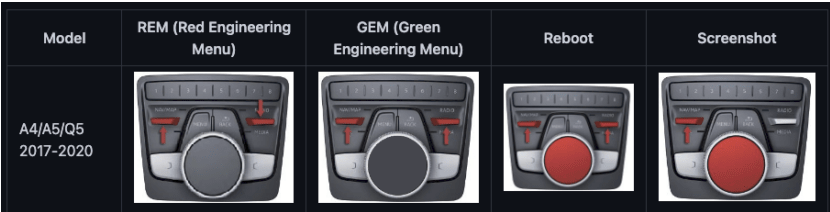

# CarPlay on the Audi Virtual Cockpit — MHI2 K3346

**English** | [Polski](README.pl.md)

> ## 📖 [Step-by-step installation guide → GUIDE.md](GUIDE.md)
> First time? Read this one. Every click explained, with what you should see after each step.

Puts Apple CarPlay on the **Virtual Cockpit** (the digital instrument cluster) of Audi cars with the
**MHI2 (Harman) infotainment, firmware `MHI2_ER_AUG22_K3346`, MU 1438**. Tested on an Audi A4 B9 with
wired CarPlay.

> ### ⚠️ Only for firmware K3346 / MU 1438
> Any other firmware: **do not install**. You do not have to check this by hand for safety — the
> installer checks it itself and refuses without changing anything — but it saves you a trip to the car.
> How to check: see [Will it work in my car?](#will-it-work-in-my-car)

## What you get

| | Feature |
|---|---|
| 🗺️ | **CarPlay map on the cockpit**, in both gauge layouts; the **VIEW** button switches layout |
| 🔍 | **Map zoom** with the left steering-wheel roller |
| ➡️ | **3D maneuver arrow** next to the map, plus distance, street name and destination flag |
| 🔙 | Map keeps running while **reversing** (the MMI shows the camera as usual) |
| 📞 | **CarPlay calls on the cockpit phone tab**: caller name, answer / reject / hang up, steering-wheel key works |
| 🕘 | **Recent calls** on the cockpit during CarPlay, dial from the list |
| 🎵 | **Album art** of the playing song on the cockpit |
| 🎙️ | **Siri** on a short press of the voice button |
| 👆 | MMI **touchpad as arrow keys** in CarPlay |

## What next?

| | Feature |
|---|---|
| 🔧 | BugFixs |
| 🎧 | CarPlay 5-speaker system support (Thanks yety-ua for your research) |
| ➡️ | Turn arrows on HUD  |
| 📞 | Own call card drawn on the CarPlay map (the stock VC popup disappears after a tab change) |

## Will it work in my car?

You need **all** of these:

- Audi with **MHI2 (Harman)** and **Virtual Cockpit** (not MHI2Q / not MIB2 Standard),
- firmware **`MHI2_ER_AUG22_K3346`**, **MU 1438** — shown in the green engineering menu or in the
  M.I.B. version screen,
- an **iPhone with CarPlay** (wired),
- [**M.I.B. – More Incredible Bash**](https://github.com/Mr-MIBonk/M.I.B._More-Incredible-Bash) on an SD
  card, already working in your car (green menu → *m.i.b.* opens). Tested with **M.I.B. 3.6.0**.
  No M.I.B. yet? How to prepare the SD card (FAT32) and install M.I.B.: [GUIDE.md, chapter 1](GUIDE.md#1-sd-card-and-mib-only-if-you-do-not-have-mib-yet).

## Before you start

- a **battery charger / power supply** on the car — the engine is off for ~20 minutes,
- a fresh **M.I.B. backup** of your unit (M.I.B. → backup),
- download from [**Releases**](../../releases/latest): `…-install.zip` and `…-uninstall.zip`.

## Install (5 steps)

*Short version for people who have done this before. **First time? Use the [step-by-step guide](GUIDE.md).***

1. **Unzip** `…-install.zip` into the **root of your M.I.B. SD card**; allow overwriting.
   It adds its own folder and replaces only `mod/command.sh`.
2. Card into the slot M.I.B. runs from (**SD1**), **ignition on**, **charger on**.
3. Green menu → **m.i.b.** → **advanced settings** → **run individual script**.
4. Wait for **`INSTALL_ALL_RESULT=PASS`** and then **`SAFE TO REMOVE SD`** (a few minutes).
   Do not switch the ignition off before that.
5. **Restart the MMI** ([how](#how-to-restart-the-mmi)). Connect the iPhone and start a
   route in CarPlay navigation.

> **Keep this SD card.** The installer saves the original car files on it
> (`mod/mib2high-carplay-rgi-v8s-simple/backup/`) and uninstalling needs them. Also copy the whole
> `mod/` folder to your computer.

### How to restart the MMI

*Buttons on A4 / A5 / Q5 (B9, 2017–2020), marked in red. From the left: red menu, **green menu**, **reboot**, screenshot. Press them on the MMI home screen. Source: [M.I.B. wiki](https://github.com/Mr-MIBonk/M.I.B._More-Incredible-Bash/wiki/%22hidden-menus%22---key-combinations).*

**A4 / A5 / Q5 (B9, 2017–2020):** hold **the big MMI knob + NAV/MAP + RADIO** together for about
10 seconds, until the screen goes dark and the MMI starts again. Other models: see the button table in
the [M.I.B. wiki](https://wiki.mibsolution.one/en/MHI2).

## Uninstall (and before every update)

*Step by step: [GUIDE.md, chapter 6](GUIDE.md#6-uninstall-and-before-every-update).*

1. Unzip `…-uninstall.zip` into the root of the **same** card (it adds one empty file, `ROLLBACK`).
2. Run the script as in step 3. Wait for **`ROLLBACK_RESULT=PASS`** and **`SAFE TO REMOVE SD`**,
   then restart the MMI. The car is back to factory state, file for file.

**Updating to a new version:** uninstall the old one, then install the new one. If you run a new
install over an existing one, it changes nothing and tells you to uninstall first.

## If something goes wrong

| You see | Meaning / what to do |
|---|---|
| `ERROR VERSION_GATE …` | Not firmware K3346 / MU1438. **Nothing was changed.** This mod is not for your unit. |
| `INSTALL_ALL_RESULT=FAIL` | The car is in a **safe state**: finished parts stay, the part that failed was undone. The reason is on the `ERROR` line. Run the script again to retry, or uninstall. |
| a line with `do not reboot` | **Do not restart the MMI.** Uninstall straight away. |
| Something does not work in the car | Collect logs and report it: see [Reporting a problem](#reporting-a-problem). |

### If the MMI does not start

Unlikely (tested in the author's car), but this is a modification
of a car computer, so: if the screen stays black or keeps restarting after step 5, wait 5 minutes and
restart once more. If that does not help, the green menu is not available, so uninstalling with M.I.B.
is not possible. Ways back:

- the **rescue card** described in [BUILDING.md](BUILDING.md#rescue-card) — boots M.I.B. through
  update mode and removes the mod's HMI part (needs a computer and some experience),
- reflashing firmware **K3346** from an SD card,
- a workshop that can reflash the MMI.

## Reporting a problem

**1. Make it happen**, then within a few minutes and **without restarting the MMI** (a restart clears
most logs):

**2. Collect logs** — green menu → m.i.b. → advanced settings → **run individual script**:

- mod installed and working (`INSTALL_ALL_RESULT=PASS` earlier): just run it — with nothing to install,
  the script collects logs;
- installation failed (`INSTALL_ALL_RESULT=FAIL`): running again would retry the install, so first unzip
  `…-collect-logs.zip` from [Releases](../../releases/latest) onto the card (it adds one empty file,
  `COLLECT_LOGS`), then run the script. The file is not removed automatically and, while it is there,
  every run only collects logs — delete it from `mod/mib2high-carplay-rgi-v8s-simple/` when done.

Wait for `COLLECT_RESULT=…` and `SAFE TO REMOVE SD`. Every run adds a new folder
`mod/mib2high-carplay-rgi-v8s-simple/collected/run-NN/` (the highest number is the newest) with: the
system log (`sloginfo.txt`), the mod's own logs (`logs/`: CarPlay hooks, route guidance, Java, maneuver
overlay), running processes, cluster display state (`dmdt-*.txt`) and `trace/metadata.txt` (mod version
from `RELEASE`, which stages are installed).

**3. Open an issue** on GitHub (Issues → New issue → *Bug report*) and write: version (file
`mod/mib2high-carplay-rgi-v8s-simple/RELEASE`), car model and year, iOS version, what you did, what you
expected, what happened, how many minutes before collecting, and a photo of the cluster/MMI if it helps.

> **Do not attach the logs to a public issue.** They contain personal data: VIN, phone name, phone
> numbers and contact names, and positions from navigation. Zip the `run-NN` folder and send it only when
> asked, privately.

## Known limitations

- **Lane guidance** (which lane to take) is wired up but **not yet seen in the car** — the test drives
  had no multi-lane maneuvers. Please report how it looks.
- **Recent calls:** with iOS 26.6–26.7.x the iPhone sends an empty list over the cable (an iOS bug that
  also hits factory BMW/Porsche clusters); the MMI's own Bluetooth list is shown instead. iOS 27.2 works.
  The full address book is not possible over CarPlay.
- After pressing **VIEW**, the maneuver arrow disappears for up to ~0.7 s and comes back in the new place.
- When there is no navigation route, the arrow tile is hidden on purpose.

**Use at your own risk.** No warranty of any kind. External power, a fresh M.I.B. backup and the
original firmware should be at hand.

## For developers

How it works, building from source, per-stage install markers and the rescue card:
**[BUILDING.md](BUILDING.md)**. Engineering log (Polish): [`docs/`](docs/), start with
[`docs/00_postep.md`](docs/00_postep.md).

## Credits

* **edzenis** – [mib2high-carplay-altscreen-rgi](https://github.com/edzenis/mib2high-carplay-altscreen-rgi),
  the base of this port (MHI2 Harman, K2161 / Q7 4M).
* **LuKa (@LuKa_dev)** – [mib2q-carplay-rgi](https://github.com/luka-dev/mib2q-carplay-rgi): RGI parser and
  bus, maneuver mapping, the 3D maneuver renderer ported here, Siri/touchpad/telephony designs, docs. His
  `docs/reference/MHI2_MU1439_PORT.md` (IDA pass over MHI2 MU1439, whose `displaymanager` is byte for byte
  the size of ours) settled the hardest question of the arrow stage: a KD window declares its displayable
  through `KD_WINDOWPROPERTY_CAPTION`, the DisplayManager composites premultiplied alpha, and the panel
  styles are 210×153 / 328×181 — all confirmed in the car. See [`docs/19`](docs/19_displayable_na_mhi2.md).
* **Eugene Chefranov (@chefranov)** – [mhi2-au37x-carplay](https://github.com/chefranov/mhi2-au37x-carplay),
  the sibling project for MHI2 AU37x. His public installer description
  (on MHI2 the cluster overlay displayable is created by the HMI from a bitmap) is what made us stop
  guessing and read the `displaymanager` binary, where `KD_WINDOWPROPERTY_CAPTION` was found. His project
  is also the existence proof that this feature set is reachable on MHI2 Harman, not only MHI2Q. No file,
  binary, jar, shader or script of his is used here.
* **joeyQuery** – MHI2-altScreen (`vc_render` origin)
* **harman-f** – mhi2_altscreen_carplay research
* **Mr-MIBonk** – M.I.B.

Licences: [LICENSING.md](LICENSING.md).
